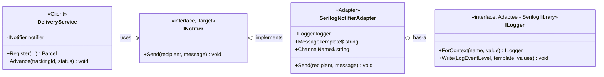
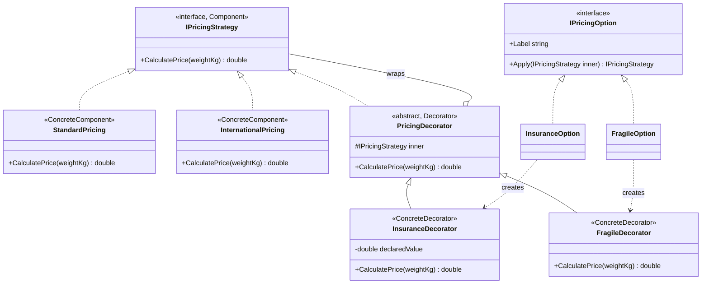
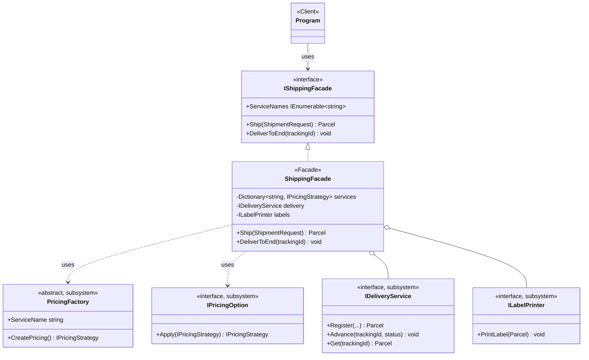

# Laboratory 2 - Structural Design Patterns: Report

## 1. Domain Description

The application is a small **parcel delivery system** (console, C#/.NET 10). A client sends a parcel by giving the recipient, the address, the weight, a delivery service (`standard`, `express`, `overnight`, `international`) and optional extras (insurance, fragile handling). The system calculates the price, gives the parcel a unique AWB code, prints the shipping label, moves the parcel through its stages (`Registered -> PickedUp -> InTransit -> Delivered`) and notifies the customer at every stage.

The project continues Laboratory 1 (Factory Method, Builder, Singleton) and Laboratory 0 (SRP, OCP, DIP). In this laboratory three structural patterns were added: **Adapter**, **Decorator** and **Facade**.

They are not isolated demos; one execution path goes through all of them:

```text
client (Program / Demo)
  -> IShippingFacade.Ship(...)                         Facade
       -> PricingFactory.CreatePricing()               Factory Method (Lab 1)
       -> IPricingOption.Apply(...)                    Decorator (pricing)
       -> IDeliveryService.Register(...)
            -> ParcelBuilder.Build(...)                Builder + Singleton (Lab 1)
            -> INotifier.Send(...)
                 -> HistoryNotifier                    Decorator (notifications)
                      -> SerilogNotifierAdapter        Adapter
                           -> Serilog.ILogger          third-party library
```

This path is checked by the test `PatternInteractionTests.Facade_Decorator_Adapter_WorkTogetherOnOnePath`.

---

## 2. Patterns

### 2.1 Adapter

**Problem it solves here.** Customer notifications must go into the company's logging pipeline, which is built on **Serilog**, a third-party library we cannot change. Our code only knows `INotifier.Send(recipient, message)`. Serilog has a different interface: `Write(level, messageTemplate, propertyValues)` and `ForContext(name, value)`. The adapter connects the two, so `DeliveryService` keeps depending on `INotifier` and does not know that Serilog exists.

**Class diagram**



**Code snippet** - [`src/Delivery.Core/Patterns/Structural/Adapter/SerilogNotifierAdapter.cs`](src/Delivery.Core/Patterns/Structural/Adapter/SerilogNotifierAdapter.cs#L21-L37)

```csharp
public SerilogNotifierAdapter(SerilogLogger logger)
{
    // Every event written through the adapter is tagged with the channel it came from.
    this.logger = logger.ForContext("Channel", ChannelName);
}

public void Send(string recipient, string message)
{
    // Translation: a notification without a recipient is not an error for us,
    // but in the logging world it must be visible, so it becomes a Warning.
    LogEventLevel level = string.IsNullOrWhiteSpace(recipient)
        ? LogEventLevel.Warning
        : LogEventLevel.Information;

    // Translation: the two plain strings become named, structured properties.
    logger.Write(level, MessageTemplate, recipient, message);
}
```

The adapter implements our interface (`INotifier`) and holds a reference to the adaptee (`Serilog.ILogger`). `Send` translates the call: it chooses a Serilog log level, turns the two strings into the named properties `Recipient` and `Text` of a message template, and adds the `Channel` context property.

**Unit tests** - [`tests/Delivery.Tests/Adapter/SerilogNotifierAdapterTests.cs`](tests/Delivery.Tests/Adapter/SerilogNotifierAdapterTests.cs)

The tests use a real Serilog logger with an in-memory sink (`CollectingSink`), so they check what Serilog actually receives.

| Test | What it checks |
|---|---|
| `Send_TranslatesTheCallIntoOneStructuredSerilogEvent` | One `Send` produces exactly one Serilog event, with level `Information`, our message template, the properties `Recipient` and `Text`, and the correct rendered text. |
| `Send_TagsEveryEventWithTheNotificationChannel` | Every event has the `Channel = customer-notification` property added by the adapter. |
| `Send_WithoutRecipient_IsTranslatedIntoAWarning` | An empty recipient becomes a `Warning` event. |
| `DeliveryService_UsesTheAdapterOnlyThroughINotifier` | `DeliveryService`, which knows only `INotifier`, sends its registration message through the adapter into Serilog. |

---

### 2.2 Decorator

**Problem it solves here.** A parcel can have extra options (insurance, fragile handling) on top of any delivery service, in any combination. With subclasses we would need `ExpressFragile`, `OvernightInsuredFragile`, `InternationalInsured` and so on. With decorators, each option is one class that wraps any `IPricingStrategy` at runtime. The same idea is used for notifications: `HistoryNotifier` wraps any `INotifier` and keeps a history of the messages.

**Class diagram** (pricing decorators)



The notification decorator has the same structure: `INotifier` (Component) <- `ConsoleNotifier`, `InMemoryNotifier`, `SerilogNotifierAdapter` (concrete components) <- `NotifierDecorator` (abstract Decorator) <- `HistoryNotifier` (ConcreteDecorator).

**Code snippet** - [`PricingDecorator.cs`](src/Delivery.Core/Patterns/Structural/Decorator/PricingDecorator.cs), [`InsuranceDecorator.cs`](src/Delivery.Core/Patterns/Structural/Decorator/InsuranceDecorator.cs#L23-L24), [`FragileDecorator.cs`](src/Delivery.Core/Patterns/Structural/Decorator/FragileDecorator.cs#L14-L15)

```csharp
public abstract class PricingDecorator : IPricingStrategy
{
    protected readonly IPricingStrategy inner;

    protected PricingDecorator(IPricingStrategy inner) => this.inner = inner;

    public virtual double CalculatePrice(double weightKg) => inner.CalculatePrice(weightKg);
}

public class InsuranceDecorator : PricingDecorator
{
    public override double CalculatePrice(double weightKg) =>
        Math.Round(base.CalculatePrice(weightKg) + Math.Max(MinFee, declaredValue * Rate), 2);
}

public class FragileDecorator : PricingDecorator
{
    public override double CalculatePrice(double weightKg) =>
        Math.Round(base.CalculatePrice(weightKg) + Fee, 2);
}
```

Each decorator *is* an `IPricingStrategy` and *has* an `IPricingStrategy`. It first asks the wrapped object for its price, then adds its own fee. Because the decorator has the same interface as what it wraps, decorators can be stacked in any order and on top of any service.

**Unit tests** - [`tests/Delivery.Tests/Decorator/`](tests/Delivery.Tests/Decorator/)

| Test | What it checks |
|---|---|
| `Decorators_StackedInAnyOrder_GiveTheSamePrice` | `Fragile(Insurance(express))` and `Insurance(Fragile(express))` both give 49.60 lei for 3.2 kg. |
| `EachDecorator_AddsExactlyItsOwnFee` | On a fixed base of 100 lei: fragile adds 10, insurance adds 2% (1000 -> +20) with a minimum of 3 lei (50 -> +3). |
| `Decorators_CanWrapAnyStrategy_AndBeRepeated` | Decorators work on `InternationalPricing` too, and the same decorator can be applied twice. |
| `Options_WrapTheStrategyWithTheirDecorator` | `InsuranceOption` and `FragileOption` return the matching decorator. |
| `HistoryNotifier_RecordsTheMessage_AndPassesItOnUnchanged` | The notification decorator records the message (with an injected clock) and passes it unchanged to the wrapped notifier. |

---

### 2.3 Facade

**Problem it solves here.** Sending one parcel needs many steps and many classes: pick the service's pricing strategy (created by a factory), wrap it with the chosen option decorators, register the parcel (Builder + Singleton inside `DeliveryService`), print the label, then move the parcel through every stage in the right order. Without a facade, the client (`Program`) would have to know all of this. `ShippingFacade` gives the client two simple methods, `Ship` and `DeliverToEnd`, and only coordinates the subsystem; it contains no pricing, validation or printing logic itself.

**Class diagram**



**Code snippet** - [`src/Delivery.Core/Patterns/Structural/Facade/ShippingFacade.cs`](src/Delivery.Core/Patterns/Structural/Facade/ShippingFacade.cs#L33-L73)

```csharp
public Parcel Ship(ShipmentRequest request)
{
    if (!services.TryGetValue(request.Service, out IPricingStrategy? pricing))
    {
        throw new ArgumentException($"Unknown service '{request.Service}'. ...");
    }

    string serviceLabel = request.Service.ToLowerInvariant();

    foreach (IPricingOption option in request.Options)
    {
        pricing = option.Apply(pricing);
        serviceLabel += " + " + option.Label;
    }

    Parcel parcel = delivery.Register(request.RecipientName, request.RecipientEmail,
        request.Destination, request.WeightKg, serviceLabel, pricing);

    labels.PrintLabel(parcel);
    return parcel;
}
```

`Ship` only calls the subsystem in the right order: choose the strategy, apply the options, register the parcel, print the label. All parts are interfaces received in the constructor, so the facade can be tested with stubs, and a new service or option does not require any change in this class.

**Unit tests** - [`tests/Delivery.Tests/Facade/ShippingFacadeTests.cs`](tests/Delivery.Tests/Facade/ShippingFacadeTests.cs)

The subsystem is replaced by stubs (`StubDeliveryService`, `StubLabelPrinter`) that write every call into one shared `CallLog`, so the order of the calls can be checked.

| Test | What it checks |
|---|---|
| `Ship_RegistersTheParcelFirst_ThenPrintsTheLabel` | The call order is `Register` then `PrintLabel`. |
| `Ship_AppliesTheOptionsAsDecorators_BeforeRegistering` | The strategy passed to `Register` is already decorated; label `express + insurance + fragile`, price 49.60. |
| `Ship_UnknownService_ThrowsAndDoesNotTouchTheSubsystem` | An unknown service throws `ArgumentException` and no subsystem method is called. |
| `DeliverToEnd_AdvancesThroughTheRemainingStagesInOrder` | The calls are `Get`, `Advance:PickedUp`, `Advance:InTransit`, `Advance:Delivered`, in this order. |
| `NewService_IsAddedByPassingANewFactory_WithoutChangingTheFacade` | A facade built with `InternationalPricingFactory` offers `international` (open for extension). |

---

### 2.4 Test run log

All tests run with one command from the `Lab2` folder: `dotnet test`.

```text
Passed Delivery.Tests.Decorator.PricingDecoratorTests.Decorators_CanWrapAnyStrategy_AndBeRepeated [2 ms]
Passed Delivery.Tests.Facade.ShippingFacadeTests.Ship_UnknownService_ThrowsAndDoesNotTouchTheSubsystem [3 ms]
Passed Delivery.Tests.Decorator.PricingDecoratorTests.Options_WrapTheStrategyWithTheirDecorator [< 1 ms]
Passed Delivery.Tests.Decorator.PricingDecoratorTests.EachDecorator_AddsExactlyItsOwnFee [< 1 ms]
Passed Delivery.Tests.Decorator.PricingDecoratorTests.Decorators_StackedInAnyOrder_GiveTheSamePrice [< 1 ms]
Passed Delivery.Tests.Facade.ShippingFacadeTests.NewService_IsAddedByPassingANewFactory_WithoutChangingTheFacade [1 ms]
Passed Delivery.Tests.Facade.ShippingFacadeTests.Ship_AppliesTheOptionsAsDecorators_BeforeRegistering [< 1 ms]
Passed Delivery.Tests.Adapter.SerilogNotifierAdapterTests.DeliveryService_UsesTheAdapterOnlyThroughINotifier [6 ms]
Passed Delivery.Tests.Decorator.HistoryNotifierTests.HistoryNotifier_RecordsTheMessage_AndPassesItOnUnchanged [5 ms]
Passed Delivery.Tests.Facade.ShippingFacadeTests.DeliverToEnd_AdvancesThroughTheRemainingStagesInOrder [1 ms]
Passed Delivery.Tests.Facade.ShippingFacadeTests.Ship_RegistersTheParcelFirst_ThenPrintsTheLabel [< 1 ms]
Passed Delivery.Tests.Adapter.SerilogNotifierAdapterTests.Send_TranslatesTheCallIntoOneStructuredSerilogEvent [1 ms]
Passed Delivery.Tests.PatternInteractionTests.Facade_Decorator_Adapter_WorkTogetherOnOnePath [7 ms]
Passed Delivery.Tests.Adapter.SerilogNotifierAdapterTests.Send_TagsEveryEventWithTheNotificationChannel [< 1 ms]
Passed Delivery.Tests.Adapter.SerilogNotifierAdapterTests.Send_WithoutRecipient_IsTranslatedIntoAWarning [< 1 ms]
Total tests: 15
Passed: 15
```

---

## 3. Patterns That Were Not Implemented

- **Bridge** - separates an abstraction from its implementation so both can vary. It would fit if, for example, notification *types* (registration, status change) had to vary independently from *channels* (e-mail, SMS, log).
- **Composite** - treats single objects and groups the same way. It would fit for a *shipment made of several parcels*, where the price of the group is the sum of the prices of its parts.
- **Flyweight** - shares common, immutable state between many objects. It could be used for the address data of cities/zones shared by thousands of parcels; in this small application there are too few objects for it to matter.
- **Proxy** - controls access to an object through a stand-in with the same interface. It would fit for a caching or access-checking proxy in front of a slow external pricing service.

---

## 4. Conclusions

**What was harder than expected.**
- Finding a *real* incompatibility for the Adapter. The first version adapted a "partner courier API" class that I had written myself, so there was no real incompatibility. Adapting Serilog was more honest: its interface (log levels, message templates, context properties) really is different from `INotifier`, and the adapter has to translate concepts, not just rename a method.
- Keeping the facade open for extension. In the first version the facade created its own factories and knew the decorators by name (`if (request.Fragile) ...`), so adding a new service or option meant editing it. Moving the factories to the constructor and turning the options into `IPricingOption` objects fixed this.
- Testing the facade. Because it created its subsystem with `new`, it could not be tested in isolation. Receiving interfaces (`IDeliveryService`, `ILabelPrinter`) made it possible to check the call order with stubs.

**What I would design differently.**
- Use `decimal` instead of `double` for money, so rounding is exact and tests do not need a precision argument.
- Let each option carry its own validation (e.g. declared value > 0) instead of leaving it to the decorator constructor.
- Use a dependency injection container (`Microsoft.Extensions.DependencyInjection`) for the composition root once the number of services grows.
