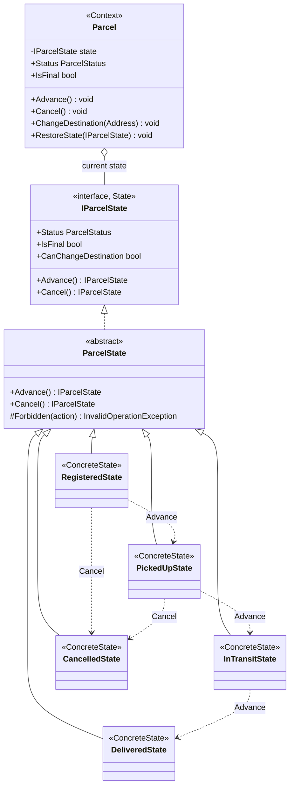
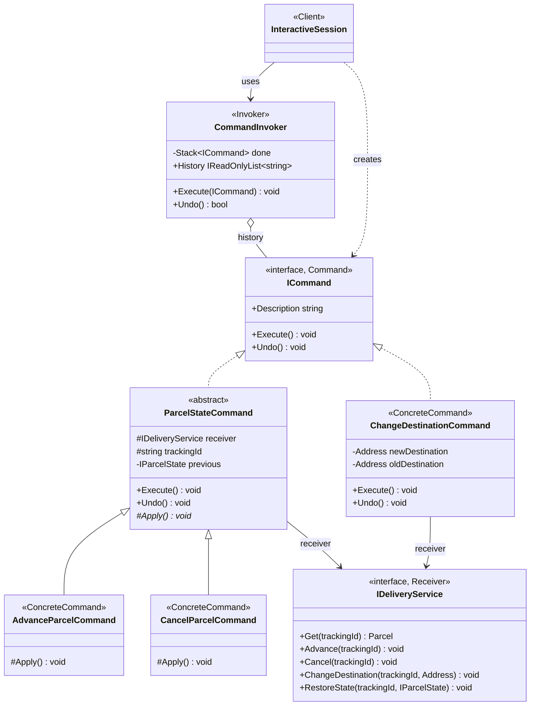
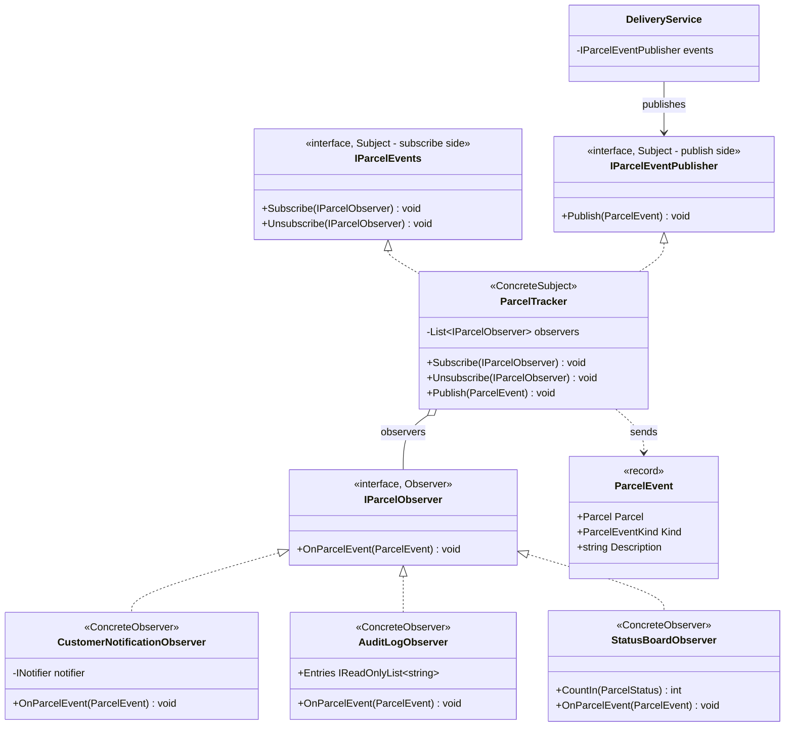

# Laboratory 3 - Behavioral Design Patterns: Report

## 1. Domain Description

The application is a **parcel delivery system** (console, C#/.NET 10). A client sends a parcel (recipient, address, weight, service, extra options); the system prices it, gives it a unique AWB code and prints the label. In this laboratory the application gets a **dispatcher** part: parcels have a real lifecycle (`Registered -> PickedUp -> InTransit -> Delivered`, or `Cancelled`), the dispatcher acts on parcels (advance, cancel, change the address) and can **undo** mistakes, and every change is announced automatically to whoever is interested (the customer, an audit log, a live status board).

The project builds on the earlier laboratories: SOLID principles (Lab 0), Factory Method, Builder, Singleton (Lab 1) and Adapter, Decorator, Facade (Lab 2). Three behavioral patterns were added: **State**, **Command** and **Observer**.

One execution path goes through all of them, and further through the Lab 2 patterns:

```text
dispatcher (menu / Demo)
  -> CommandInvoker.Execute(AdvanceParcelCommand)          Command (Invoker -> Command)
       -> IDeliveryService.Advance(trackingId)              Command (Receiver)
            -> Parcel.Advance() -> IParcelState.Advance()   State (Context -> ConcreteState)
            -> IParcelEventPublisher.Publish(ParcelEvent)   Observer (Subject)
                 -> CustomerNotificationObserver            Observer (ConcreteObserver)
                      -> HistoryNotifier                    Decorator (Lab 2)
                           -> SerilogNotifierAdapter        Adapter (Lab 2) -> Serilog
                 -> AuditLogObserver
                 -> StatusBoardObserver
```

This path is checked by the test `PatternInteractionTests.Command_ChangesState_AndEveryObserverIsNotified_ThroughTheLab2Chain`.

**Behavior changes at runtime** (advanced requirement A): in the interactive mode the dispatcher moves parcels between states with commands, undoes them, and switches observers on and off (`customer notifications on/off`, `status board on/off`) while the program runs.

---

## 2. Patterns

### 2.1 State

**Problem it solves here.** What may be done with a parcel depends on where it is: a registered parcel can be cancelled or redirected, a parcel on the road cannot, a delivered one cannot be touched at all. In Lab 2 this was an array of statuses and an `if` in `DeliveryService`; adding a rule meant more `if`s. Now each status is a class that decides its own allowed transitions and whether the address may change. `Parcel` (the context) only delegates to its current state; there is no `switch` on the status anywhere.

**Class diagram**



**Code snippet** - [`Domain/Parcel.cs`](src/Delivery.Core/Domain/Parcel.cs#L33-L51), [`Patterns/Behavioral/State/ParcelStates.cs`](src/Delivery.Core/Patterns/Behavioral/State/ParcelStates.cs)

```csharp
// Context (Parcel): delegates to the current state, which returns the next state.
public void Advance() => state = state.Advance();
public void Cancel() => state = state.Cancel();

public void ChangeDestination(Address newDestination)
{
    if (!state.CanChangeDestination)
        throw new InvalidOperationException($"The address cannot be changed when the parcel is {Status}.");
    Destination = newDestination;
}

// Concrete states: each one overrides only what is allowed for it;
// everything else throws in the base class ParcelState.
public class PickedUpState : ParcelState
{
    public override ParcelStatus Status => ParcelStatus.PickedUp;
    public override bool CanChangeDestination => true;
    public override IParcelState Advance() => new InTransitState();
    public override IParcelState Cancel() => new CancelledState();
}

public class InTransitState : ParcelState
{
    public override ParcelStatus Status => ParcelStatus.InTransit;
    public override IParcelState Advance() => new DeliveredState();
}
```

The parcel never checks its own status: it calls the same method on whatever state object it holds, and the behavior differs because the object differs. The transitions are written inside the states (`PickedUp -> InTransit`), not in the client code, and a forbidden action is rejected by the base class `ParcelState`.

**Unit tests** - [`tests/Delivery.Tests/State/ParcelStateTests.cs`](tests/Delivery.Tests/State/ParcelStateTests.cs)

| Test | What it checks |
|---|---|
| `ValidTransitions_LeadFromRegisteredToDelivered` | Calling `Advance` until the end goes through `Registered, PickedUp, InTransit, Delivered`, in this order. |
| `Cancel_IsAllowedBeforeTransit_AndRejectedInTransit` | `Cancel` works in `Registered`; in `InTransit` it throws and the status stays the same. |
| `FinalStates_RejectEveryTransition` (Delivered, Cancelled) | Final states reject both `Advance` and `Cancel`. |
| `ChangeDestination_IsDecidedByTheCurrentState` | The address can be changed in `Registered`, not in `InTransit`; a rejected change leaves the address unchanged. |

---

### 2.2 Command

**Problem it solves here.** The dispatcher makes mistakes (scans the wrong parcel, types the wrong address) and must be able to undo them. The actions also need a history. Turning each action into an object that knows how to `Execute` and `Undo` itself makes this possible. The commands contain no business logic: they call the receiver (`IDeliveryService`) and only remember what is needed to undo.

**Class diagram**



**Code snippet** - [`ParcelStateCommands.cs`](src/Delivery.Core/Patterns/Behavioral/Command/ParcelStateCommands.cs#L22-L50), [`CommandInvoker.cs`](src/Delivery.Core/Patterns/Behavioral/Command/CommandInvoker.cs#L14-L31)

```csharp
// ParcelStateCommand: remember the state before, let the receiver do the work.
public void Execute()
{
    IParcelState before = receiver.Get(trackingId).State;
    Apply();
    previous = before;   // saved only if Apply() did not throw
}

public void Undo()
{
    if (previous is null) throw new InvalidOperationException("The command was not executed.");
    receiver.RestoreState(trackingId, previous);
    previous = null;
}

public class AdvanceParcelCommand : ParcelStateCommand
{
    protected override void Apply() => receiver.Advance(trackingId);
}

// CommandInvoker: knows only ICommand; keeps a stack for undo.
public void Execute(ICommand command)
{
    command.Execute();          // if it throws, it is not added to the history
    done.Push(command);
    history.Add($"done: {command.Description}");
}

public bool Undo()
{
    if (!done.TryPop(out ICommand? command)) return false;
    command.Undo();
    history.Add($"undone: {command.Description}");
    return true;
}
```

The invoker works only with `ICommand`, so it can run, store and undo any action without knowing what it does. Each command keeps the data needed to reverse itself (the previous state object, or the old address), and the stack makes undo go in reverse order. A command rejected by the State pattern throws before it is pushed, so it never appears in the undo history.

**Unit tests** - [`tests/Delivery.Tests/Command/CommandTests.cs`](tests/Delivery.Tests/Command/CommandTests.cs)

| Test | What it checks |
|---|---|
| `AdvanceThenUndo_RestoresTheOriginalState` | After `Execute` + `Undo` the parcel is `Registered` again, and the restored state works normally. |
| `ChangeDestinationThenUndo_RestoresTheOldAddress` | After `Undo` the parcel has exactly the old `Address` object. |
| `Invoker_UndoesCommandsInReverseOrder` | Advance then Cancel; two undos give `PickedUp`, then `Registered`. |
| `RejectedCommand_IsNotAddedToTheHistory` | A command forbidden by the state throws, is not in the history, and the next undo reverts the previous command. |
| `Undo_WithNothingDone_ReturnsFalse` | Undo on an empty history is safe and returns `false`. |

---

### 2.3 Observer

**Problem it solves here.** When a parcel changes, several unrelated parts must react: the customer must be notified, the dispatcher's audit log must record it, the status board must update its counts. In Lab 2 `DeliveryService` called the notifier directly; adding a new reaction meant editing it. Now `DeliveryService` only publishes a `ParcelEvent` to the subject (`ParcelTracker`), and any number of observers subscribe or unsubscribe at runtime.

**Class diagram**



**Code snippet** - [`ParcelTracker.cs`](src/Delivery.Core/Patterns/Behavioral/Observer/ParcelTracker.cs#L10-L27), [`DeliveryService.cs`](src/Delivery.Core/Services/DeliveryService.cs#L49-L54)

```csharp
// ConcreteSubject: knows observers only through IParcelObserver.
public void Subscribe(IParcelObserver observer)
{
    if (!observers.Contains(observer))
        observers.Add(observer);
}

public void Unsubscribe(IParcelObserver observer) => observers.Remove(observer);

public void Publish(ParcelEvent e)
{
    // A copy, so an observer may unsubscribe while it is being notified.
    foreach (IParcelObserver observer in observers.ToArray())
        observer.OnParcelEvent(e);
}

// DeliveryService: changes the parcel, then only publishes; it does not know who listens.
public void Advance(string trackingId)
{
    Parcel parcel = Get(trackingId);
    parcel.Advance();
    Publish(parcel, ParcelEventKind.StatusChanged, $"new status - {parcel.Status}.");
}
```

The subject keeps a list of `IParcelObserver` and calls the same method on each one; it never references a concrete observer. Observers do not change parcels, so a notification cannot start an endless update loop. Iterating over a copy of the list makes it safe for an observer to unsubscribe during a notification.

**Unit tests** - [`tests/Delivery.Tests/Observer/ParcelTrackerTests.cs`](tests/Delivery.Tests/Observer/ParcelTrackerTests.cs)

| Test | What it checks |
|---|---|
| `AllSubscribedObservers_AreNotified` | Two subscribed observers both receive the same event. |
| `UnsubscribedObserver_IsNotNotified` | After `Unsubscribe`, the observer receives nothing; the others still do. |
| `SubscribingTwice_StillNotifiesOnce` | The same observer subscribed twice is notified only once. |
| `ObserverMayUnsubscribeWhileBeingNotified` | An observer that unsubscribes itself during a notification does not break the loop. |
| `ReceiverChanges_ReachTheConcreteObservers` | Real `DeliveryService` changes reach `CustomerNotificationObserver` (via `INotifier`) and `StatusBoardObserver`. |

---

### 2.4 Test run log

All tests run with one command from the `Lab3` folder: `dotnet test`. Lab 2 tests (Adapter, Decorator, Facade) were kept and adapted.

```text
Passed Delivery.Tests.Observer.ParcelTrackerTests.SubscribingTwice_StillNotifiesOnce [4 ms]
Passed Delivery.Tests.Facade.ShippingFacadeTests.Ship_UnknownService_ThrowsAndDoesNotTouchTheSubsystem [4 ms]
Passed Delivery.Tests.Command.CommandTests.Invoker_UndoesCommandsInReverseOrder [6 ms]
Passed Delivery.Tests.Command.CommandTests.AdvanceThenUndo_RestoresTheOriginalState [< 1 ms]
Passed Delivery.Tests.Command.CommandTests.Undo_WithNothingDone_ReturnsFalse [< 1 ms]
Passed Delivery.Tests.Command.CommandTests.RejectedCommand_IsNotAddedToTheHistory [< 1 ms]
Passed Delivery.Tests.Facade.ShippingFacadeTests.NewService_IsAddedByPassingANewFactory_WithoutChangingTheFacade [1 ms]
Passed Delivery.Tests.Command.CommandTests.ChangeDestinationThenUndo_RestoresTheOldAddress [< 1 ms]
Passed Delivery.Tests.Facade.ShippingFacadeTests.Ship_AppliesTheOptionsAsDecorators_BeforeRegistering [< 1 ms]
Passed Delivery.Tests.Decorator.HistoryNotifierTests.HistoryNotifier_RecordsTheMessage_AndPassesItOnUnchanged [9 ms]
Passed Delivery.Tests.Decorator.PricingDecoratorTests.Decorators_CanWrapAnyStrategy_AndBeRepeated [< 1 ms]
Passed Delivery.Tests.Facade.ShippingFacadeTests.Ship_RegistersTheParcelFirst_ThenPrintsTheLabel [1 ms]
Passed Delivery.Tests.Decorator.PricingDecoratorTests.Options_WrapTheStrategyWithTheirDecorator [< 1 ms]
Passed Delivery.Tests.Observer.ParcelTrackerTests.ReceiverChanges_ReachTheConcreteObservers [4 ms]
Passed Delivery.Tests.Observer.ParcelTrackerTests.AllSubscribedObservers_AreNotified [< 1 ms]
Passed Delivery.Tests.Decorator.PricingDecoratorTests.EachDecorator_AddsExactlyItsOwnFee [< 1 ms]
Passed Delivery.Tests.Observer.ParcelTrackerTests.UnsubscribedObserver_IsNotNotified [< 1 ms]
Passed Delivery.Tests.State.ParcelStateTests.ChangeDestination_IsDecidedByTheCurrentState [< 1 ms]
Passed Delivery.Tests.Decorator.PricingDecoratorTests.Decorators_StackedInAnyOrder_GiveTheSamePrice [< 1 ms]
Passed Delivery.Tests.Observer.ParcelTrackerTests.ObserverMayUnsubscribeWhileBeingNotified [< 1 ms]
Passed Delivery.Tests.State.ParcelStateTests.Cancel_IsAllowedBeforeTransit_AndRejectedInTransit [< 1 ms]
Passed Delivery.Tests.Facade.ShippingFacadeTests.DeliverToEnd_AdvancesUntilTheParcelReachesAFinalState [< 1 ms]
Passed Delivery.Tests.Adapter.SerilogNotifierAdapterTests.Send_TranslatesTheCallIntoOneStructuredSerilogEvent [12 ms]
Passed Delivery.Tests.PatternInteractionTests.Command_ChangesState_AndEveryObserverIsNotified_ThroughTheLab2Chain [10 ms]
Passed Delivery.Tests.Adapter.SerilogNotifierAdapterTests.DeliveryService_ReachesTheAdapterOnlyThroughAnObserverAndINotifier [< 1 ms]
Passed Delivery.Tests.Adapter.SerilogNotifierAdapterTests.Send_TagsEveryEventWithTheNotificationChannel [< 1 ms]
Passed Delivery.Tests.Adapter.SerilogNotifierAdapterTests.Send_WithoutRecipient_IsTranslatedIntoAWarning [< 1 ms]
Passed Delivery.Tests.State.ParcelStateTests.FinalStates_RejectEveryTransition(state: Delivered) [< 1 ms]
Passed Delivery.Tests.State.ParcelStateTests.FinalStates_RejectEveryTransition(state: Cancelled) [< 1 ms]
Passed Delivery.Tests.State.ParcelStateTests.ValidTransitions_LeadFromRegisteredToDelivered [< 1 ms]
Total tests: 30
Passed: 30
```

---

## 3. Open for Extension

| New variant | What is added | What is edited |
|---|---|---|
| New command (e.g. "hold at depot") | one `ICommand` class (+ a menu entry in the client) | nothing in Core |
| New observer (e.g. SMS, statistics export) | one `IParcelObserver` class, subscribed in `CompositionRoot` | nothing in Core |
| New state (e.g. `Returned` after a failed delivery) | one `ParcelState` subclass | only the state(s) that lead to it (here `InTransitState`), which is how the State pattern is meant to change: the transition rule lives in the state that owns it |

---

## 4. Patterns That Were Not Implemented

- **Chain of Responsibility** - would fit for validating a shipment request through a chain of checks (weight, address, forbidden goods, customs), where each handler either rejects the request or passes it on.
- **Iterator** - would fit for walking through the parcels of one route in delivery order without exposing how the route is stored.
- **Mediator** - would fit if couriers, depots and the dispatcher had to coordinate with each other; they would talk through a central dispatcher object instead of referencing each other.
- **Memento** - could replace the `RestoreState` used by undo: the parcel would produce a snapshot of its full state (status + address) that only it can read.
- **Strategy** - already used since Lab 0 for pricing (`IPricingStrategy`); not counted as one of the three new patterns.
- **Template Method** - `ParcelStateCommand` is close to it: `Execute()` is the fixed skeleton (save state, apply, remember) and subclasses fill in `Apply()`.
- **Visitor** - would fit for adding reports over different shipment types (letters, parcels, pallets) without changing their classes.
- **Interpreter** (good to know) - would fit for a small query language for the dispatcher, such as `status = InTransit and city = Chisinau`.

---

## 5. Conclusions

**What was harder than expected.**
- Undo for state transitions. A transition goes forward (`PickedUp -> InTransit`), but there is no rule for going back, and adding a `Back()` to every state would mix "undo" into the business rules. The solution was for the command to remember the previous state object and ask the receiver to restore it.
- Deciding who publishes the events. If the `Parcel` itself were the subject, every parcel would need its own list of observers. A single subject (`ParcelTracker`) that `DeliveryService` publishes to was simpler and lets observers subscribe once for all parcels.
- Keeping the Lab 2 tests passing after `DeliveryService` stopped calling `INotifier` directly: the notifier is now reached through `CustomerNotificationObserver`, so the tests had to follow the new path.

**What I would design differently.**
- Use a real Memento for undo, so the command does not need to know about `IParcelState` at all.
- Give `ParcelEvent` a typed payload (old status, new status) instead of a ready-made description, so each observer can format the message its own way.
- Keep the commands in the history together with the time and the user who ran them, for a more useful audit.
